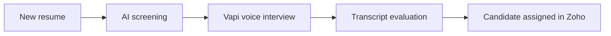

<!-- Banner + typing effect -->

  

  

<!-- Links -->

  
  
  
  
    
  

---

## ⚡ About me

- 🤖 **AI Automation Trainee** at Rhydburg Pharmaceutical, building n8n and Zoho workflows for regulatory, recruitment and finance operations.
- 🧠 I combine LLM decision-making (**Google Gemini**, **MCP**, **Vapi** voice AI) with document parsing and rule-based orchestration, so people stay in control through approvals and status notifications.
- 🎓 **MCA**, SGRR University (2024 to 2026), and a **Master Data Science** certification from GUVI HCL × IIT Madras Pravartak.
- 📊 Data science foundation: fraud detection at **0.98 AUC-ROC** on 284K+ transactions, and a **DistilBERT** fake news model deployed as a live API.
- 🏆 **Best Startup Idea** award at the SGRR Innovation Seminar (IIC).
- 🔭 Learning next: **Generative AI, MLOps and LLM agents**.

### How my automations flow

---

## 🚀 Featured work

| Project | What it does | Stack |
|---|---|---|
| [Credit Card Fraud Detection](https://github.com/UjjwalThapliyal123/Credit-Card-Fraud-Detection-Automated-Big-Data-ML-Pipeline) | PySpark pipeline on 284K+ transactions, SMOTE for imbalance, SHAP for explainability. **0.98 AUC-ROC** | PySpark, XGBoost, SHAP, MLflow |
| [Swiggy & CRED Review Analysis](https://github.com/UjjwalThapliyal123/Swiggy-Cred-Product-health-Analysis) | 25K+ reviews analyzed to find when satisfaction broke. Confirmed a **1.3-star decline** | VADER, PELT, TF-IDF |
| [Fake News Detector](https://huggingface.co/spaces/abc22u59na/fake-news-detector) | DistilBERT fine-tuned on 70K+ records, served as a FastAPI service. **82% test accuracy** | DistilBERT, FastAPI, Docker |
| [Job Recommendation Engine](https://github.com/UjjwalThapliyal123/Job-Recommendation-system) | Ranks job descriptions against a resume with cosine similarity | TF-IDF, Streamlit |
| [FlipSatisfy Classifier](https://github.com/UjjwalThapliyal123/Flipkart-s-Customers_Survey) | Predicts satisfaction from 85,907 support messages. **95.6% to 96.9%** accuracy | scikit-learn, MLflow, FastAPI |

---

## 🛠️ Tech stack

**Automation & AI** 

  
**Programming & Data** 

  
**Machine Learning & NLP** 

  
**Deployment & Tools** 

---

## 📊 GitHub stats

  
  

 

  

---

  Have a process worth automating? <a href="https://portfolio-ujjwal-thapliyal.netlify.app/#contact">Send me a brief</a>.

